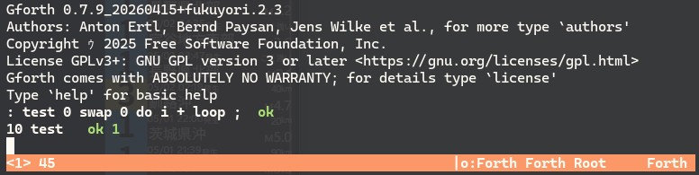

# Gforth README

This repository is a fork of
[forthy42/gforth](https://github.com/forthy42/gforth) that has been modified so
Gforth can be built, run, and packaged natively on Windows.  It is currently
based on `Gforth 0.7.9_20260923` and this fork's current release version is
`0.7.9_20260923+fukuyori.3.3`.

Gforth is a fast and portable implementation of ANS Forth and Forth 200x.  The
upstream project remains the base of this repository; this fork adds a native
Windows build path, Windows terminal fixes, and an Inno Setup-based installer
flow.

## What This Fork Adds

Compared with the upstream repository, this fork currently focuses on:

- native Windows builds without requiring MSYS2 or MinGW at runtime
- a usable interactive REPL in Windows Terminal and WezTerm
- Windows packaging with a per-user Inno Setup installer
- PowerShell scripts for native build, release staging, and installer creation

For the Windows-specific implementation details, see `docs/WINDOWS-NATIVE.md`.

## Quick Start

### Native Windows build

Build the native runtime, image builder, and default image on Windows:

```powershell
.\scripts\build-native.ps1
```

This produces:

- `build/native/gforth.exe`
- `build/native/gforth-ditc.exe`
- `build/native/gforth.fi`

`gforth.exe` uses the stable indirect-threaded engine on Windows.
`gforth-ditc.exe` is a packaging helper used to create fully relocatable
images; normal interactive use should continue to launch `gforth.exe`.

Run the native build:

```powershell
.\build\native\gforth.exe
```

Run the advanced interactive image with the status bar enabled:

```powershell
.\scripts\run-advanced.ps1
```

The script enables the status bar and uses `.gforth-advanced-history` for
advanced history persistence.  To run the same path manually:



```powershell
$env:GFORTHHIST = ".gforth-advanced-history"
$env:GFORTH_WIN_STATUS = "1"
.\build\native\gforth.exe -i .\build\native\gforth-advanced.fi
```

Smoke test:

```powershell
.\build\native\gforth.exe -e '1 2 + . cr bye'
```

### Windows installer

Create the release build first:

```powershell
.\scripts\build-release.ps1
```

This produces the native runtime files and stages the installer input tree:

- `build/native/gforth.exe`
- `build/native/gforth-ditc.exe`
- `build/native/gforth.fi`
- `build/native/gforth-advanced.fi`
- `build/installer/stage/`

Electronically sign `build/installer/stage/gforth.exe` and
`build/installer/stage/gforth-ditc.exe`, then create the installer from the
signed staged release build:

```powershell
.\scripts\build-installer.ps1
```

The installer output is written to:

- `build/installer/output/gforth-native-<version>-x64-setup.exe`

#### Launching after installation

The installer defaults to launching the **advanced interactive mode** (status
bar plus persistent history).  After installation, every entry point below
starts Gforth in advanced mode:

- Start menu → **Gforth Native**
- Desktop shortcut **Gforth Native** (only when "Create a desktop shortcut" is
  checked during setup)
- The **Launch Gforth Native** checkbox on the final setup page

These all run `gforth-advanced.cmd` in the install directory, which is
equivalent to:

```powershell
$env:GFORTH_WIN_STATUS = "1"
$env:GFORTHHIST = "<install-dir>\.gforth-advanced-history"
gforth.exe -i gforth-advanced.fi
```

The installer regenerates `gforth-advanced.fi` with the bundled
`gforth-ditc.exe`.  This keeps the image fully relocatable and prevents its
primitive checksum from becoming invalid when Windows ASLR chooses a different
address after a reboot.

The default install directory is `%LOCALAPPDATA%\Programs\Gforth`.

To launch from a terminal (requires the "Add Gforth to PATH" task during
setup):

```powershell
# Advanced mode (status bar + history)
gforth-advanced.cmd

# Plain mode (no status bar)
gforth.exe
```

Without PATH set, use the full path:

```powershell
& "$env:LOCALAPPDATA\Programs\Gforth\gforth-advanced.cmd"
```

Extra arguments are forwarded to Gforth (for example
`gforth-advanced.cmd myprog.fs`).  If `gforth-advanced.fi` is missing, the
launcher falls back to the plain `gforth.fi` image.

### Upstream-style builds

This repository still contains the normal upstream source tree and build
machinery for Unix-like systems.  For those paths, see:

- `INSTALL`
- `INSTALL.md`
- `INSTALL.BINDIST`

## Documentation Guide

Use these entry points depending on what you want to do:

- `docs/WINDOWS-NATIVE.md`: native Windows build, terminal behavior, and installer flow
- `docs/WINDOWS-RELEASE-3.1.md`: causes, fixes, and verification for the Windows-native 3.1 release
- `docs/WINDOWS-TERMINAL-CONTRACT.md`: terminal input/output behavior contract
- `docs/WINDOWS-INTERACTIVE-PLAN.md`: recovery plan for interactive features (history, ekey, status line)
- `docs/WINDOWS-INTERACTIVE-BASELINE.md`: verification baseline records for the interactive work
- `docs/CHANGELOG.md`: release history of this fork
- `docs/version-update-checklist.md`: files to update when changing the version
- `INSTALL.md`: build from source, especially from git
- `INSTALL`: general installation notes from the traditional build flow
- `INSTALL.BINDIST`: installation from binary distributions
- `docs/LICENSE-NOTICE-TEMPLATE.md`: release and installer notice templates for this fork

## Repository Layout

The files most relevant to the Windows-native fork are:

- `compat/win32/`: Windows compatibility headers and source
- `engine/`: runtime and terminal handling code
- `kernel/`: Forth kernel sources, including interactive input handling
- `scripts/build-native.ps1`: native Windows build entry point
- `scripts/build-release.ps1`: release build and staging entry point
- `scripts/stage-native-dist.ps1`: installer staging step
- `scripts/build-installer.ps1`: Inno Setup wrapper for an existing staged release
- `installer/gforth-native.iss`: Windows installer definition

The wider tree still contains the upstream Gforth sources, examples, add-ons,
tests, and packaging files for other environments.

## Fork Synchronization

In this fork, `origin` is expected to point to the fork repository and
`upstream` is expected to point to the original repository.

Check your remotes:

```powershell
git remote -v
```

**Policy: follow tagged upstream releases only.**  This fork takes in the
latest *tagged* upstream release (`0.7.9_YYYYMMDD`).  Upstream branches
(`master` and others) and commits made between tags are not merged; wait for
the next tag.  The fork's base version (the `0.7.9_YYYYMMDD` part of
`0.7.9_YYYYMMDD+fukuyori.X.Y`) must match the merged tag exactly.  If no newer
tag exists, there is nothing to sync.

Bring a tagged release into this fork with a merge:

```powershell
git fetch upstream --tags
git tag --list "0.7.9_*" --sort=-creatordate    # pick the newest upstream tag
git checkout main
git merge <tag>                                  # e.g. 0.7.9_20260923
git push origin main
```

Do not push upstream's tags to `origin`; push only this fork's own release
tags.

The sync merge of 2026-07-11 (`0.7.9_20260708+fukuyori.3.0`) connected this
fork's history with upstream, so plain merges work from now on.  When
resolving conflicts, keep the fork's Windows-specific changes; the files that
carry them are listed in `docs/WINDOWS-NATIVE.md`.

### Bootstrap artifacts (WSL Gforth)

The generated bootstrap artifacts (`prim.b`, `engine/*.i`, `kernel/prim.fs`,
`kernel/aliases.fs`, `kernl64l.fi`) are git-ignored.  Generating them needs a
full-image Gforth as bootstrap host; the fork's own installed `gforth.fi` is
a compact kernel image and cannot host the generators.

| Situation | WSL Gforth needed? |
| --- | --- |
| Ordinary rebuild; `prim`, `kernel/` and the startup libraries are unchanged and the artifacts exist | No: `scripts\build-native.ps1 -SkipBootstrap` |
| Advanced-image creation, installer-time image generation | No: they use only the fork's own `gforth.exe`, `gforth-ditc.exe` and `kernl64l.fi` |
| After merging upstream changes to `prim`, `kernel/` or the startup libraries | **Yes**: regenerate first |
| Fresh clone (no artifacts yet) | **Yes**: regenerate first |

Regenerate with a full Gforth in WSL (needs `gforth`, `m4` and `python3` in the
WSL distribution; the Gforth used so far is 0.7.9_20260410):

```powershell
.\scripts\regen-bootstrap.ps1             # regenerate, rebuild the engine, copy the kernel image
.\scripts\regen-bootstrap.ps1 -SkipBuild  # regenerate only
```

The script runs `scripts/regen-bootstrap-wsl.sh` in WSL, then
`build-native.ps1 -SkipBootstrap`, and copies `kernl64l.fi` to
`build\native\gforth.fi`.  Afterwards rebuild the advanced image
(`scripts\build-advanced-interactive-image.ps1 -IncludeHistory`, or
`scripts\build-release.ps1 -SkipNative`).  Do not leave artifacts generated
from a different `prim` in place: an engine and a kernel image built from
different `prim` files make advanced-image creation fail with
`Primitive ... is not implemented by this engine`.

`regen-bootstrap.ps1` records a SHA256 of every kernel input (`kernel/*.fs`,
`prim`, `cross.fs`, `machpc.fs`, `mach64l.fs`) in `kernl64l.fi.inputs`.
`build-advanced-interactive-image.ps1` (and so `build-release.ps1`) compares it
with the current sources and warns when `kernl64l.fi` is older than they are,
naming the changed files; it also warns when `build/native/gforth.fi` (or the
staged `gforth.fi`) differs from `kernl64l.fi`.  The warnings do not stop the
build.  Because `kernel/accept.fs` and the other kernel files are compiled into
`kernl64l.fi`, run `regen-bootstrap.ps1` after changing them.

Other bootstrap options (official Windows Gforth with `-BootstrapExe`, or
upstream snapshot tarball artifacts) are described under "Bootstrap
requirements after an upstream sync" in `docs/WINDOWS-NATIVE.md`.

Normal development should push to `origin`, not to `upstream`.

## Upstream Project and Support

The upstream Gforth project is part of the GNU Operating System and remains the
base project for this fork.  General Gforth discussion and support still follow
the usual upstream channels:

- Usenet: `comp.lang.forth`
- Mailing list: `gforth@gnu.org`
- Bug tracker: <https://savannah.gnu.org/bugs/?func=addbug&group=gforth>

If you are publishing releases from this fork, keep the existing upstream
copyright and license notices intact.

## License

Gforth is distributed under the GNU General Public License; see `COPYING`.

---

Authors: Bernd Paysan, Anton Ertl, Gerald Wodni
Copyright (C) 1995,1996,1997,1998,2000,2003,2004,2006,2007,2008,2009,2016,2017,2018,2019,2020,2021,2022,2023 Free Software Foundation, Inc.

This file is part of Gforth.

Gforth is free software; you can redistribute it and/or
modify it under the terms of the GNU General Public License
as published by the Free Software Foundation, either version 3
of the License, or (at your option) any later version.

This program is distributed in the hope that it will be useful,
but WITHOUT ANY WARRANTY; without even the implied warranty of
MERCHANTABILITY or FITNESS FOR A PARTICULAR PURPOSE.  See the
GNU General Public License for more details.

You should have received a copy of the GNU General Public License
along with this program. If not, see http://www.gnu.org/licenses/.
